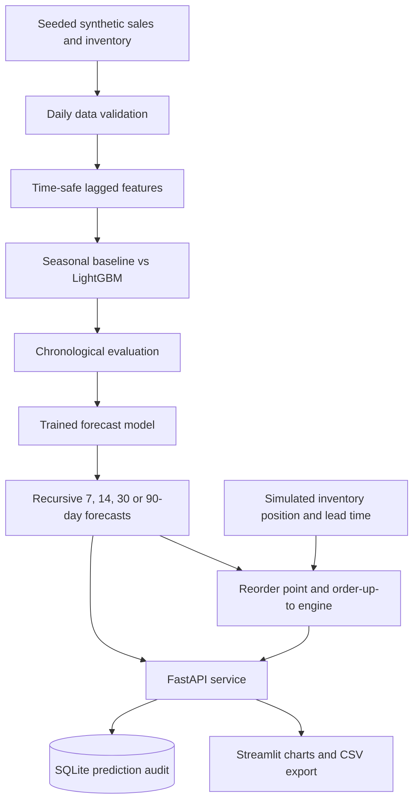
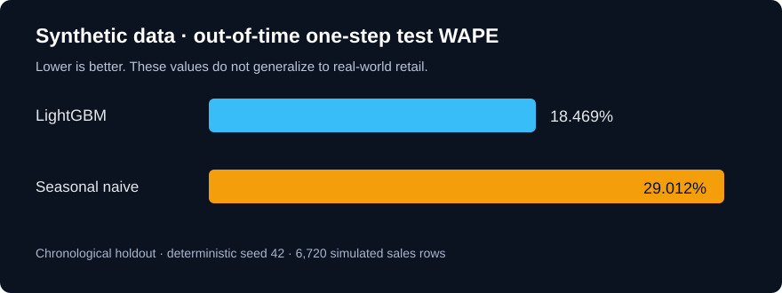

> Historical detailed project guide. The root README and repository inventory describe currently available files; older release notes may refer to external bundles or earlier versions.

# 📈 DemandPilot AI

### End-to-end Demand Forecasting & Inventory Optimization Platform — Portfolio Demo

[](https://github.com/harshakavali81-collab/DemandPilot-AI-Enterprise-AI-Demand-Forecasting-Inventory-Optimization-Platform/actions/workflows/ci.yml)

**DemandPilot AI** demonstrates an integrated retail forecasting application built with Python, Pandas, LightGBM, scikit-learn, FastAPI, Streamlit, Plotly, SQLite and Docker Compose. It predicts daily observed sales and recommends reorder quantities using simulated inventory balances and supplier lead times.

> **Important:** all bundled data is generated, not provided by real retailers. Forecast metrics, inventory balances and risk predictions are synthetic demonstration results. This is not a commercially validated inventory system and no live deployment has been verified.

## Quick start

Requires Python 3.10+ and an internet connection to install dependencies.

```bash
git clone https://github.com/harshakavali81-collab/DemandPilot-AI-Enterprise-AI-Demand-Forecasting-Inventory-Optimization-Platform.git
cd DemandPilot-AI-Enterprise-AI-Demand-Forecasting-Inventory-Optimization-Platform
python -m venv .venv
# Windows:
.venv\Scripts\activate
# Linux/macOS:
# source .venv/bin/activate
pip install -e ".[dev]"
python scripts/bootstrap.py
pytest -q
uvicorn demandpilot.api.main:app --reload
```

In **a second terminal** after activating your environment:

```bash
streamlit run dashboard/app.py
```

- **Dashboard:** http://localhost:8501
- **Swagger REST API:** http://localhost:8000/docs
- **Docker option:** `docker compose up --build`

`bootstrap.py` generates 420 days of daily sales for 8 products in 2 stores, writes SQLite tables, trains an actual LightGBM regression model, compares the baseline and exports model files and evaluation reports. No API key or paid cloud service is required.

## Architecture diagram



## Screens and key capabilities

| Section | Features |
|---|---|
| Overview | SKU-store totals, simulated risk alerts, recommended units, indicative order costs |
| Demand Forecast | Choose store/product, 7/14/30/60/90 days, daily plots, heuristic uncertainty ranges, CSV export |
| Inventory Planner | What-if lead times, stock, on-order, backorders, error uncertainty, service-level target |
| Model Evaluation | Seasonal baseline vs LightGBM; chronological validation and held-out test WAPE, MAE, RMSE |
| API | `GET /health`, `GET /catalog`, `POST /forecast`, `GET /inventory/alerts`, `POST /inventory/recommend`, `GET /metrics` |
| Engineering | Pytest, GitHub Actions CI, Docker Compose, Pydantic request validation, SQLite audit |



## Complete source tree

```text
DemandPilot-AI/
├── .github/workflows/ci.yml
├── .env.example
├── .gitignore
├── README.md
├── pyproject.toml
├── Dockerfile
├── docker-compose.yml
├── data/
│   ├── raw/
│   ├── processed/         # Generated data, gitignored
│   └── sample/sales_demo.csv
├── artifacts/             # Trained model and metrics generated on bootstrap
├── src/demandpilot/
│   ├── config.py
│   ├── data/
│   │   ├── generate.py
│   │   └── validate.py
│   ├── features/build_features.py
│   ├── modeling/
│   │   ├── train.py
│   │   ├── forecast.py
│   │   └── evaluate.py
│   ├── inventory/optimizer.py
│   ├── storage/database.py
│   └── api/
│       ├── schemas.py
│       └── main.py
├── dashboard/app.py
├── notebooks/01_exploratory_analysis.ipynb
├── scripts/
│   ├── bootstrap.py
│   ├── seed_demo.py
│   ├── prepare_data.py
│   ├── train_model.py
│   ├── make_report.py
│   └── forecast_example.py
├── tests/
│   ├── test_features.py
│   ├── test_forecast.py
│   ├── test_inventory.py
│   ├── test_training.py
│   └── test_api.py
├── reports/figures/
└── docs/
    ├── architecture.md
    ├── data_dictionary.md
    ├── model_card.md
    └── deployment.md
```

## How it works

1. **Generate and validate data:** synthetic retail sales, products, promotions and simulated stock are checked for invalid values, gaps and duplicate days.
2. **Create forecasting features:** lag 1/7/14/28, trailing 7/28 means, historical standard deviation, calendar, price and promotions. Target-day sales never enter feature construction.
3. **Select a model chronologically:** choose LightGBM or the last-week-same-day baseline by validation WAPE, then evaluate both on out-of-time test data.
4. **Forecast demand:** recurse one day at a time, using prior model predictions for future unknown lags, never future actuals.
5. **Make replenishment decisions:** calculate stock position, protection-window expected demand, safety stock, reorder point, order-up-to and recommended units. Stockout probability is an approximate Normal-model heuristic.
6. **Serve the results:** FastAPI validates and persists forecast requests; Streamlit displays interactive charts and downloadable results.
7. **Reproduce, test and package:** CI tests on Python 3.11/3.12; Docker Compose runs API and dashboard.

## Measured synthetic holdout benchmark

These values were computed locally from seed 42, 420-day simulated history; they **are not real-business accuracy claims**.

| Model | Validation WAPE | Held-out one-step test WAPE |
|---|---:|---:|
| LightGBM | 19.241% | 18.469% |
| Last-week seasonal naive | 29.736% | 29.012% |

MAE and RMSE are stored in the generated `artifacts/metrics.json`. These are **one-step** metrics only; a production-ready project must add rolling-origin multi-step backtests and independently calibrated prediction intervals.

## Documentation

- [Architecture, data flow and APIs](docs/architecture.md)
- [Data dictionary and provenance](docs/data_dictionary.md)
- [Model card and limitations](docs/model_card.md)
- [Installation, Docker and API examples](docs/deployment.md)

## How to describe DemandPilot in interviews

> Designed and implemented DemandPilot AI, an end-to-end machine learning demand forecasting and inventory decision-support demo. Built time-safe features and chronological LightGBM evaluation against a seasonal baseline, served recursive forecasts using FastAPI, and created Streamlit dashboards and a stock replenishment engine. Added SQLite persistence, API testing, CI, and Docker Compose. Validated results on reproducible simulated retail data.

**Future work:** use licensed real-world datasets, stockout demand-censoring corrections, dedicated multi-horizon backtesting, properly calibrated intervals, real supplier lead-time distributions, model drift monitoring, authentication and cloud deployment.

Maintained by [harshakavali81-collab](https://github.com/harshakavali81-collab).
