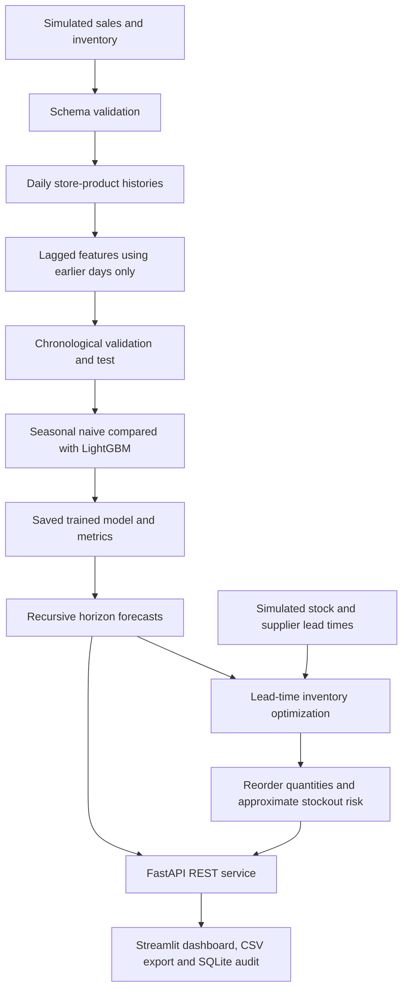

# System architecture

## API contract

- `GET /health`: API liveness information.
- `GET /catalog`: synthetic store-product catalog.
- `POST /forecast`: forecast 1–90 days for known product and store; optionally set future price and known promotion days.
- `GET /inventory/alerts`: compute sample stockout risk and order recommendation for each store-product.
- `POST /inventory/recommend`: user-provided daily forecast, lead time, review period, stock and service target.
- `GET /metrics`: chronological validation and out-of-time test comparison.

All scores and inventory simulations are demonstration values, not independently validated commercial outcomes. This is a single-user educational app, NOT a multi-tenant authenticated ERP integration.
